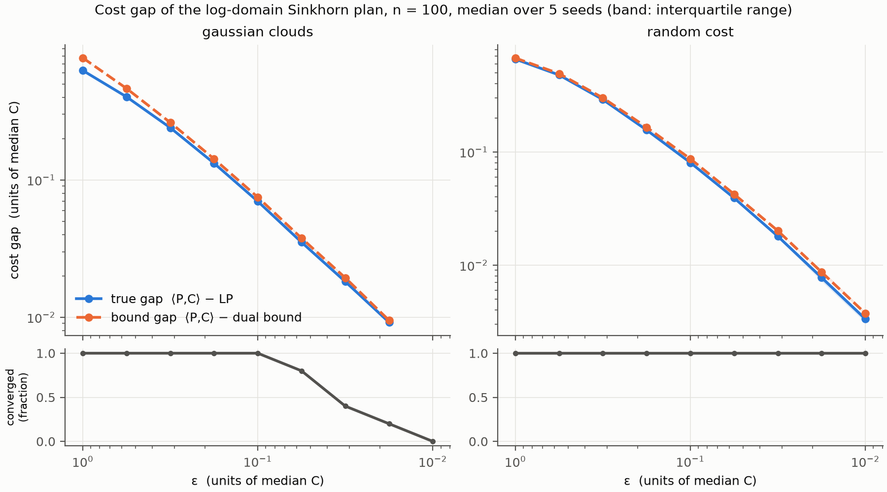
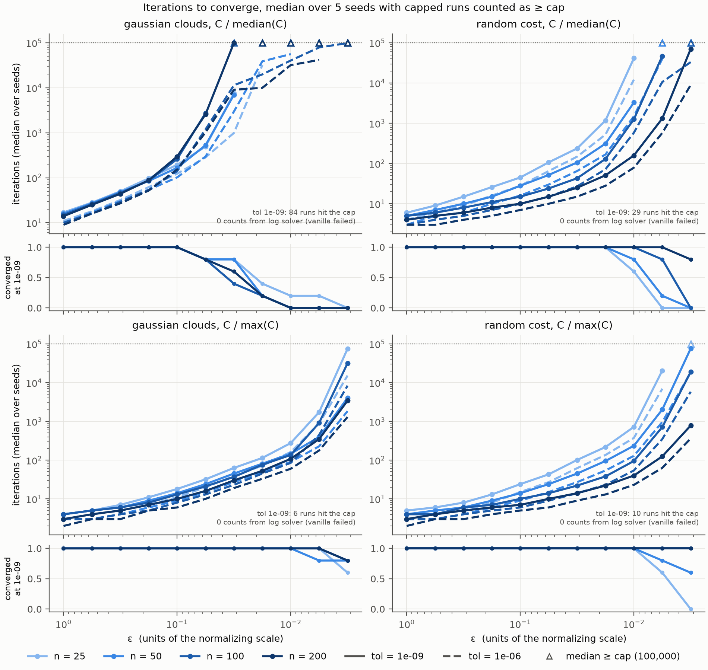
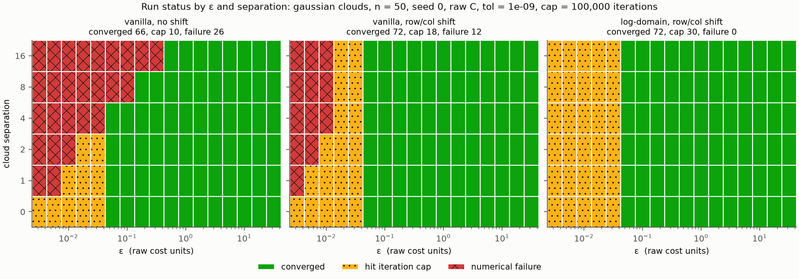

# sinkhorn-lab

[](https://github.com/nicholasyschaap-math/sinkhorn-lab/actions/workflows/ci.yml)

Entropic optimal transport with the Sinkhorn algorithm: plain, shifted and
log-domain solvers, checked against an exact linear-programming solution.

## Question and finding

**Question:** What breaks in Sinkhorn's algorithm as ε → 0, and what solution is best in various cases?

**Finding:** On separated Gaussian clouds (n = 50, raw squared-Euclidean
cost), vanilla Sinkhorn without stabilization fails numerically in 26 of 102
settings, and the failing region grows with the cost scale: at separation 16
it fails at every ε ≤ 0.32. Shifting the cost by its row and column minima
(vanilla + shift) cuts the failures to 12 settings, all at ε ≤ 0.01, and the
log-domain solver (log + shift) never fails. What remains is speed, not
stability: for ε ≤ 0.03 the log-domain solver hits the 100,000-iteration cap at
tolerance 1e-9 in all 30 settings. The marginal error falls quickly to around
1e-6 and then decreases very slowly.


Run status (converged, hit the iteration cap, numerical failure) for each solver
over ε and cloud separation: Gaussian clouds, n = 50, seed 0, raw
squared-Euclidean cost, tolerance 1e-9, cap 100,000 iterations.

## Results

### Cost gap against ε



The Sinkhorn transport cost exceeds the exact optimum by a gap that shrinks
steadily with ε. For random costs, the median gap falls from 0.66 at ε = 1 to
0.0033 at ε = 0.01, in units of the median cost.

The dual lower bound from `lp_dual_bound` needs no exact solve. Details on the relative
strength of its bound can be found in the next section.

Gaussian clouds converge at tolerance 1e-9 in all 5 seeds only down to
ε = 0.1, and in none at ε = 0.01. Only converged runs enter the gap curves,
because a capped plan is off its marginals.

Setting: n = 100, costs divided by their median, 5 seeds; median and
interquartile range over seeds; log-domain solver with the row/column shift;
tolerance 1e-9, cap 100,000. Vanilla gives the same status on every run here.

### Dual lower bound against the LP optimum

`lp_dual_bound` turns any dual potentials into a certified lower bound on the
exact optimal cost. It applies the c-transform, which makes the duals feasible,
then takes the dual objective. The bound needs no exact solve, so the interval
[bound, Sinkhorn cost] contains the optimum on problems too large for an LP
solver.

[`tests/test_metrics.py`](tests/test_metrics.py) compares it with the
certified LP optimum on six problems:
- Gaussian clouds, square and rectangular, the rectangular one with separation 2;
- random costs;
- a one-dimensional problem;
- non-uniform weights;
- zero-mass bins.

The bound comes from the log-domain solver's duals at five values of ε, given
in units of each problem's median cost. Runs are capped at 20,000 iterations.

The table shows the relative shortfall of the bound, (LP − bound)/LP:

| Problem | ε = 1 | 0.3 | 0.1 | 0.03 | 0.01 |
|---|---|---|---|---|---|
| Gaussian clouds 30 × 30 | 28% | 5.9% | 1.5% | 0 (exact)† | 0 (exact)† |
| Gaussian clouds 25 × 40, separated | 17% | 4.5% | 1.1% | 0.32% | 0.15% |
| Random cost 30 × 20 | 26% | 12% | 5.8% | 2.8% | 0.75% |
| 1-D, n = 30 | 48% | 12% | 3.7% | 0.91% | 0.12%† |
| Non-uniform weights 25 × 20 | 33% | 9.0% | 4.2% | 1.2% | 0.40% |
| Zero-mass bins 24 × 18 | 22% | 5.8% | 2.6% | 1.2% | 0.45% |

† The Sinkhorn run hit the iteration cap. Its duals still give a valid bound.

**The bound never exceeds the LP optimum.** This holds on all 30 runs, and
also for randomly drawn duals that come from no solver at all.

**It tightens at every step as ε shrinks.** At ε = 0.01 it is within 1% of the
optimum on every problem, and within 0.45% on five of the six.

**On the 30 × 30 clouds at ε ≤ 0.03, the c-transform recovers the exact LP
optimum** (to rounding), even though the Sinkhorn run itself did not converge.
So a bound computed from an unconverged run can still be exact.

**The bound often sits closer to the optimum than the Sinkhorn cost does.** On
the separated clouds at ε = 0.01, for example, the bound is 0.15% below the
optimum and the Sinkhorn cost is 0.27% above it.

Figure 1 shows the same tightening at n = 100, with 5 seeds per point.

### Iterations on geometric and random costs



**Random costs: larger problems converge in fewer iterations under both
normalizations.**
- Under median normalization, iterations decrease with n at 8 of 9 ε values.
  Across n = 25–200, the largest-to-smallest ratio of iteration counts is
  about 4.5.
- Under max normalization the ratio is about 3.9.

**Gaussian clouds: the ordering depends on normalization.**
- Under median normalization, the curves for different n nearly coincide
  (ratio 1.18).
- Under max normalization they separate (ratio 2.0), though the ordering
  is mixed at about half the ε values.

**The tolerance limits convergence more than the cap does.** On
median-normalized Gaussian clouds at ε = 0.01, 5% of runs reach 1e-9 within
the cap, while 75% reach 1e-6.

Setting: vanilla + shift, which did not fail on any normalized problem here.
5 seeds per point. Each curve is the median over seeds, with a capped run
counted as "at least the cap". An open triangle means the median itself is at
or above the cap.

### Where each solver succeeds



**Without the shift, vanilla's failures track the raw cost scale.** As the
separation grows from 0 to 16, the largest raw cost grows from 26 to 406, and
the largest failing ε grows from none to 0.32.

**With the shift, separation matters much less.**
- The largest shifted cost only grows from 24.7 to 36.7.
- Vanilla + shift fails only at ε ≤ 0.01, for every separation of 1 or more.
- For squared-Euclidean cost, moving one cloud changes C by a term in i plus a
  term in j, so the transport plan itself does not change with separation.
  The separation affects only the numerics.

**The log-domain solver never fails.** It hits the iteration cap at
ε ≤ 0.03 at every separation.

Setting: as in the caption above, 17 values of ε from 0.003 to 30 and 6
separations, a single seed.

### Cost of the log domain

The timing figure (cost per iteration and time to convergence for both solvers)
has not been measured yet. It needs a dedicated, otherwise idle machine and will
be added in a later release.

## Method

Notation follows Peyré and Cuturi, *Computational Optimal Transport*:
weights `a`, `b`, cost `C`, kernel `K = exp(-C/ε)`, plan `P`, scalings `u`, `v`,
and dual potentials `f`, `g`. The full derivation is in
[`docs/derivation.md`](docs/derivation.md).

| Solver | Description |
|---|---|
| `vanilla_sinkhorn(..., stabilize="none")` | Alternating scaling updates on `K` |
| `vanilla_sinkhorn(..., stabilize="rowcol")` | The same updates on a row- and column-shifted cost, which leaves the plan unchanged |
| `log_sinkhorn` | Updates on `f` and `g` with log-sum-exp |

**Stopping rule:** a run stops when the row-marginal error ‖P1 − a‖₁ falls
below `tol`, which defaults to 1e-9.
- The column marginal is exact to rounding after each `v` or `g` update, so
  only the rows are checked.
- The check runs before each update and reuses the product that the update
  needs, so it adds almost nothing to the cost of an iteration.

**What every run returns:** both solvers return the same result: the plan `P`,
the duals `f` and `g` on the original cost, the cost ⟨P, C⟩, a `status`, the
iteration count and `err`.

**Status** is one of:
- `"converged"`;
- `"max_iter"`: the cap was reached, by default 100,000 iterations. `err` is
  still the row-marginal error of the returned plan.
- `"numerical_failure"`: the scalings or duals became non-finite, or a
  vanilla scaling reached 0. `err` is NaN, and the plan is not meaningful.

Zero-mass bins are removed before solving and restored afterward as zero rows
and columns of `P`, with dual potentials of `NaN`, since they are undetermined.

## Verification

Exact solutions come from POT's network simplex solver (`ot.emd`). The
wrapper raises an error rather than return an unverified answer:
- it rejects inputs that POT would silently rescale;
- it certifies every solution by primal feasibility, dual feasibility,
  complementary slackness and a zero duality gap.

The exact baseline is itself checked against independent references: the
closed-form sorted solution for one-dimensional problems, scipy's
`linear_sum_assignment` for uniform square problems, and scipy's HiGHS linear
program for general weights.

The solver tests run on both solvers unless noted. The LP references don't
use POT, and any warning counts as a failure. They check:

- both marginals of every solver's plan,
- that the plan equals `exp((f + g − C)/ε)` for the reported duals,
- `P → abᵀ` for large ε,
- the transport cost approaching the exact cost as ε shrinks, and never falling below it beyond what the marginal error allows,
- identical plans with and without the row/column shift, and under row and column offsets or a joint rescaling of `C` and ε,
- correct handling of zero-mass bins, matching a solve on the reduced problem,
- the status, iteration count and error reported for capped and failing runs,
- agreement between the vanilla and log-domain solvers wherever vanilla converges,
- a 2000 × 2000 problem,
- for the dual lower bound: never above the LP optimum; tightening as ε shrinks, to within 1% at ε = 0.01; recovering the exact optimum from exact duals; valid for arbitrary finite duals; unchanged by a constant shift of the duals; and correct with zero-mass bins.

The tests were checked by deliberately breaking the solvers and the bound in
about 25 different ways and confirming that tests fail each time. A failing instance
found while probing the solvers is kept as a regression test: 20-point clouds
at separation 3 and ε = 0.003, where vanilla + shift fails.

## Running it

Requires Python 3.12 or newer.

```bash
git clone https://github.com/nicholasyschaap-math/sinkhorn-lab.git
cd sinkhorn-lab
python -m venv .venv && source .venv/bin/activate
pip install -e ".[dev]"
```

Run the tests and the linter:

```bash
pytest -q
ruff check .
```

Regenerate a figure. Each script writes a CSV and a PNG to `figures/`:

```bash
python experiments/fig1_cost_gap.py
python experiments/fig2_iterations.py
python experiments/fig3_stability.py
```

- `sh experiments/run_figures_1_3.sh` runs all three.
- Each script takes about 8–10 minutes on one thread of an Apple-silicon
  MacBook Pro.
- Runs are saved to the CSV as they finish, and a rerun skips them, so an
  interrupted script can be restarted.
- `python experiments/<script>.py plot` redraws a figure from its CSV without
  rerunning anything.

## Repository layout

```text
src/sinkhorn_lab/
    problems.py     seeded problem generators
    exact.py        exact baseline, wrapping POT
    solvers.py      Sinkhorn solvers
    metrics.py      dual lower bound on the exact cost
tests/              tests run on every commit
experiments/        one script per figure
figures/            CSVs and PNGs produced by the experiments
docs/
    derivation.md   the derivation, typed up
implementation.md   layout and conventions for contributors and agents
DECISIONS.md        design choices, the alternatives, and the evidence
AGENTS_LOG.md       what the coding agents did
```

## How this was built

I wrote the solvers (`solvers.py`), the measurements (`metrics.py`) and the
derivation by hand. A coding agent (Claude Code) wrote supporting
code under review: the problem generators, the exact-solver wrapper, the tests,
the experiment scripts and CI. It also made a few small edits to
`solvers.py` and `metrics.py` at my request, each approved explicitly. Every
agent change was reviewed and tested before being committed. See
[`AGENTS_LOG.md`](AGENTS_LOG.md) for each task, and
[`DECISIONS.md`](DECISIONS.md) for the design choices.

## Planned updates

- **Timing (figure 4).** The next addition is the timing experiment: cost
  per iteration and time to convergence for both solvers. It measures the
  price of running in the log domain.
- **Applied implementation: hedge portfolios for derivatives.** An applied
  implementation is planned, optimizing hedge portfolios for derivatives,
  based on the work of Yoshihiro Tawada and Shin Kobayashi.
- **Stress tests in the applied setting.** The test suite will be extended
  to apply this repository's stress testing of algorithmic limits and
  failures to the applied framework, judging how well the method works in
  practice. The investigation will cover:
  - **Whether the log domain is necessary for such applications:** how close
    to the optimal solution the output must be in this domain, and whether
    that tolerance consistently requires the log domain.
  - **The effect of cost-matrix shifting and scaling** from the current
    suite on performance in the applied setting.
  - **How tightly the optimum can be bounded when exact solutions are too
    expensive.** The connection between the LP solver and the dual bound
    will be used to measure how tightly the optimum can be bracketed in
    real-world cases, which shows how precisely the approach can be used.

## Limitations

- **Small problems.** Problem sizes are modest: n = 100 in figure 1,
  25–200 in figure 2 and 50 in figure 3. Behaviour at larger n is untested
  beyond one 2000 × 2000 test.
- **Few seeds.** Figures 1 and 2 use 5 seeds per point and figure 3 a single
  seed. Among converged runs in figure 2, iteration counts differ by more
  than 10× between seeds in 55 settings, and by up to about 300×, so the
  medians are rough.
- **Two cost families.** Only squared-Euclidean Gaussian clouds and uniform
  random costs are tested, all with uniform weights. The finding that
  separation leaves the plan unchanged is specific to squared-Euclidean cost.
- **Normalization relabels ε.** Dividing `C` by its median or maximum
  rescales ε; it does not change the solver's stability. Figures 1 and 2 use
  normalized costs; figure 3 uses raw costs.
- **"Converged" depends on the tolerance and cap.** It means reaching 1e-9
  within 100,000 iterations; near the cap, other choices would move the
  boundaries.
- **No timings yet.** Figure 4 is pending.
- **The dual-bound results come from small problems.** They come from six
  problems of up to 40 points per side, and figure 1 at n = 100. How tight the
  bound is on large or applied problems is untested; this is part of the
  planned work.
- **No input validation for equal masses or finite costs.** The solvers don't
  check these for hand-built inputs. The generators always produce valid
  problems.

## References

- Peyré, G. and Cuturi, M. [Computational Optimal Transport](https://arxiv.org/abs/1803.00567). *Foundations and Trends in Machine Learning*, 2019.
- Cuturi, M. [Sinkhorn Distances: Lightspeed Computation of Optimal Transport](https://papers.nips.cc/paper/2013/hash/af21d0c97db2e27e13572cbf59eb343d-Abstract.html). *NeurIPS*, 2013.
- Flamary, R. et al. [POT: Python Optimal Transport](https://pythonot.github.io/). *Journal of Machine Learning Research*, 2021.

## License

MIT. See [`LICENSE`](LICENSE).
